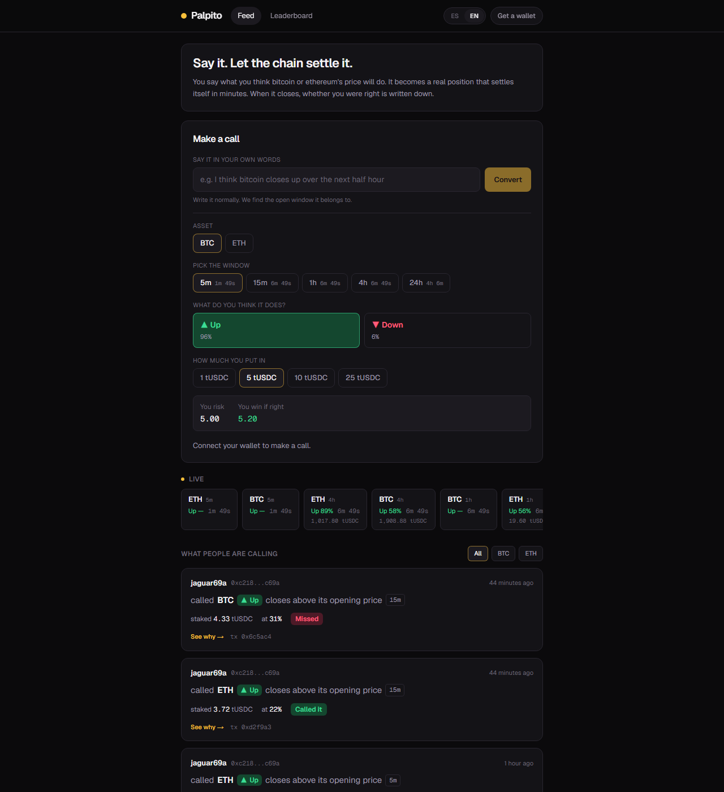
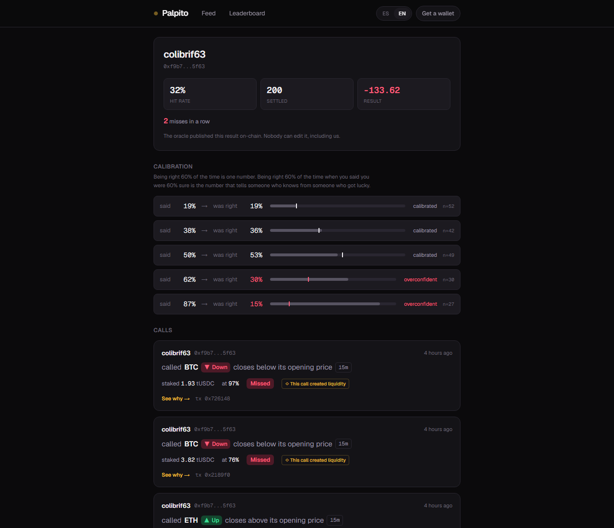
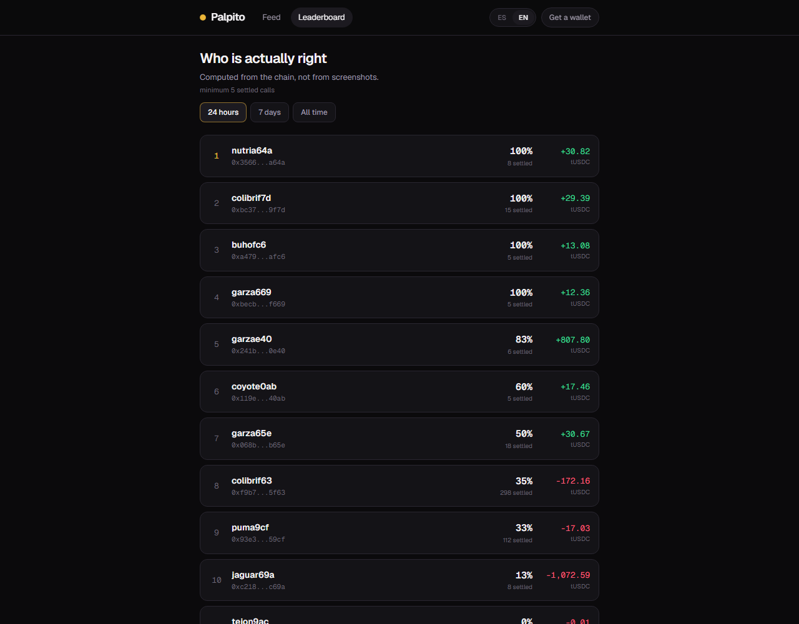

# Palpito

**Say it. Let the chain settle it.**

A social feed for price calls on [DreamDEX](https://docs.dreamdex.io) event contracts, running on Somnia testnet. You say what you think BTC or ETH will do, it becomes a real on-chain position, and minutes later the oracle publicly settles whether you were right — with a receipt anyone can audit.

Built for the Somnia × DreamDEX Event Contracts Hackathon. Spanish and English, Spanish by default.

---

## The problem

Everyone in crypto says they called it. Nobody proves it. Screenshots are editable, threads get deleted, and the loudest voice wins by default.

Event contracts already solve the hard half of this: a call becomes a fully-collateralized position that an on-chain oracle settles by itself, with no keeper and no operator in the loop. What was missing is the part humans actually use — somewhere to *see* the calls, see who made them, and see who turned out to be right.

Palpito is that layer.

## What it does

- **A feed of live calls.** Every card is a real fill on a real event-contract market, with a ticking countdown to its window close.
- **A verifiable receipt.** Once a market settles, every call's *See why* opens the window's receipt: the line it opened against, the closing price the oracle published, and the settlement transaction on the Somnia testnet explorer. Not our word for it.
- **A record nobody can edit.** Hit rate, settled calls and P&L for any wallet that has ever traded this venue, recomputed from the public indexer on every request. There is no database behind the reputation layer, on purpose.
- **A leaderboard of who is actually right**, over wallets with enough settled calls to mean something.
- **Making a call**, end to end: connect an injected wallet, pull testnet collateral from the public faucet without leaving the page, and buy the UP or DOWN side of a live window. (Built against the SDK; see *Status* for what has and has not been signed end to end.)
- **Calibration, not just accuracy.** The price you pay is your stated confidence, so a profile shows what you claimed against what happened. One wallet on this venue sits at a 35% hit rate and is well calibrated everywhere — except when it says 83%, where it is right 26% of the time.
- **Getting out early.** Open positions surface under the composer with a live exit price; sell before the window closes instead of waiting for the result.
- **Agreeing or disagreeing in one tap.** Every live call in the feed carries *join* and *fade*; a settled one carries a receipt instead.
- **Saying it in words.** "no creo que el bitcoin suba esta hora" fills in ETH/DOWN/1h by itself; "who wins the derby on Sunday" gets told, plainly, what this venue can and cannot do.

## Why the social layer is not decoration

Event contracts settle a crossing of `Buy Up × Buy Down` by **minting a fresh pair** — two opposite-side buyers need no seller and no market maker. So on this venue, two people disagreeing *is* the liquidity event.

That is a strange property for a trading venue and a completely ordinary property for a social feed. Palpito leans on it twice. The calls marked `◇ created liquidity` are fills that existed only because two people took opposite sides of the same window — and the **fade** button next to every live call is that mechanism offered directly: disagreeing with someone here does not consume liquidity, it *is* the liquidity event.

## Running it

```bash
npm install && npm run dev
```

That is the whole setup. Every read path is public — the Somnia markets indexer needs no key, and the app ships with the deployed contract addresses. Open http://localhost:3000.

**To make a call**, you need two testnet balances:

1. **STT for gas** — from the Somnia faucet at <https://testnet.somnia.network/>.
2. **tUSDC to stake** — the button in the app calls the collateral token's public
   `faucet(uint256)` and mints you 10,000. No form, no queue, no asking anyone.

Step 1 has to come first: minting tUSDC is itself a transaction.

**Before a live demo**, run `npm run snapshot` once. It writes a dated,
real snapshot of the venue's current markets and recent calls to
`docs/demo-snapshot.json` — not a fallback the app itself reads, but
something to have open in a tab if the live venue lands on zero open
windows mid-pitch. The app always talks to the real venue; this is only
ever narrated over, never passed off as live.

## Architecture

```
Next.js (App Router, RSC)
        │
        ├── reads ──▶ Somnia markets indexer (Hasura GraphQL, public)
        │              markets · fills · resolutions · venues
        │
        └── links ──▶ Shannon explorer (settlement tx of each window)
```

| Path | What it is |
|---|---|
| `src/lib/somnia.ts` | Chain, addresses, venue, window catalog |
| `src/lib/indexer.ts` | Every read + the scoring rules (`outcomeOf`, `buildStanding`) |
| `src/lib/i18n.ts` | Both dictionaries; a missing key is a type error |
| `src/lib/parse.ts` | The deterministic sentence parser |
| `src/lib/book.ts` | Live best-ask per side, read from the pool |
| `src/lib/useJoin.ts` | One-tap join / fade on someone else's call |
| `src/lib/positions.ts` | Open positions, from the indexer |
| `src/lib/useSell.ts` | Exiting a position before its window closes |
| `src/app/api/parse/route.ts` | The Claude fallback (optional) |
| `src/app/page.tsx` | The feed |
| `src/app/ranking/page.tsx` | Leaderboard |
| `src/app/u/[wallet]/page.tsx` | Any wallet's record |

**Network:** Somnia testnet (chain 50312). **Collateral:** tUSDC, 6 decimals, public faucet.

---



*The whole product in one screen. The composer prices from the pool's live book;
the strip below shows every open window with its countdown and traded volume; the
feed is real fills by real wallets, each carrying its verdict and a link to the
oracle.*



*Calibration is the part a hit rate hides. This wallet is at 32% overall and
well calibrated at 19%, 38% and 50% — then says 87% and is right 15% of the time.
That band is the useful thing to know about them.*



*Ranked over 24 hours by default, with 7- and 30-day tabs. There is no all-time
tab: the venue has carried well over 60,000 settled calls since July, the public
indexer has no aggregates, and one request scores at most 2,000 of them — so when
that cap is hit the board says from which date it counts, and so does a profile
past its 500 latest calls. Both count the same set as the wall (the real 5m–24h
windows, never the venue's 60-second test series). Every number here is
recomputed from the public indexer, so anyone can check it.*

*What "See why" opens today: the market page's receipt — the line the window
opened against, the price the oracle published at the close (both from the
indexer's `strike` and `OracleAnswer.numericValue`, in cents), and a link to the
settlement transaction on the Somnia testnet explorer. This is what turns a
leaderboard into evidence.*

*(Until November 2026 this linked the Prophecy oracle explorer instead. That
link pointed at `prd.oracle.somnia.host`, which is the mainnet oracle: it showed
unrelated questions for old ids and "question not found" for every id since the
venue's 2026-09-30 switch to hashed question ids. The old screenshot,
`docs/img/oracle-receipt.png`, is kept only as history.)*

---

## Deliverables

| | |
|---|---|
| Live prototype | <https://palpito-somnia.vercel.app> (Somnia testnet) |
| Repository | <https://github.com/ALFA117/palpito> |
| Demo script | [DEMO_SCRIPT.md](DEMO_SCRIPT.md) — shot list and timings |
| SDK feedback report | [FEEDBACK.md](FEEDBACK.md) — nine findings, with repros |
| Backlog | [BACKLOG.md](BACKLOG.md) — what we would do next, ranked |

## Notes for the DreamDEX team

Nine findings, each with a repro and a suggestion, in [FEEDBACK.md](FEEDBACK.md).
The short version:

1. **`clobStatus` in the indexer is not usable as a liveness filter.** It still reads `Trading` on markets whose window closed over a month ago. Filtering on it returns a wall of expired rows and sorts the genuinely live markets off the end of the page. Liveness has to be derived from the clock instead — `expiry > now AND tradingStart <= now AND NOT finalized AND NOT voided`. The gotchas page warns that the indexed status *lags*, which reads as "by seconds"; in practice it does not converge at all.

2. **The public docs undersell the venue.** `trading/event-contracts.md` says "15-minute and 1-hour windows". Testnet is currently running 5m, 15m, 1h, 4h and 24h windows for both BTC and ETH — a much better story for anyone building a consumer app, and worth saying out loud.

3. **`VENUE_ID` really does move, and there is no documented way to discover it.** The bot kit warns about this and ships a value; there is no `venues` query in the docs to resolve it from. We infer it by counting live markets per venue, which works but is a heuristic every builder will have to reinvent.

4. **Test-harness markets share the venue with real ones.** Testnet carries 3s/45s/60s windows and questions prefixed `Pricefeed test:` alongside the real series. Anything user-facing has to allowlist real intervals, and a new test interval would otherwise leak straight into a consumer feed.

5. **The HTTP API's spot-only scope is easy to miss.** `GET /v0/markets` returns three spot pairs and no event contracts, with no error signalling that event contracts live elsewhere. A pointer in the response, or a documented note at the endpoint itself, would save a first-time integrator an hour.

6. **`lastPrice` is easy to mistake for a quote.** It is the last trade, and on a
   thin window it can sit an order of magnitude away from the live ask — we saw a
   market last-trade at 0.42 with a 0.044 ask resting. Anything user-facing has to
   read the book. A note on the field, or a `bestBid`/`bestAsk` pair on the market
   row, would stop a whole class of mispriced integrations.

7. **`getOutcomeBalance` in the recipes page does not compile.** The published
   snippet calls it positionally —
   `client.getOutcomeBalance(onchain.outcomeToken, me, onchain.yesId)` — but in
   markets-sdk 0.28.1 it takes a single params object,
   `{ outcomeToken, account, id }`. Following the docs passes a string where the
   object is expected, so both fields read `undefined` and the failure surfaces
   from deep inside viem as `Address "undefined" is invalid` on a `balanceOf`
   the caller never wrote. The error names neither the function nor the argument.

8. **`getMarketOnchain` returns a hollow object for a market that just rolled.**
   No throw, no null — `pool` and `outcomeToken` come back `undefined`, and the
   program continues until some later call trips over them with the same opaque
   viem error as above. On a venue whose whole design is that markets "die on
   schedule and respawn", this is a race every integrator will hit. Returning
   null, or throwing, would make it self-describing.

9. **The oracle explorer deep link needs the right network, and it stopped resolving.** `prd.oracle.somnia.host` is the *mainnet* oracle (chain 5031); testnet questions live on `dev.oracle.somnia.host` (chain 50312). Since the venue moved to hashed 77-digit `oracleQuestionId`s on 2026-09-30, neither explorer finds them. The indexer still has everything a receipt needs — `MarketResolutionEvent.txHash` and `OracleAnswer.numericValue` — so that is what Palpito reads now.

## Reading a sentence

The composer resolves in two stages, and the order is the point.

A **deterministic parser** goes first. The domain is genuinely small — two assets,
two directions, five windows — so the phrasings people actually type resolve from
patterns, instantly and offline. That keeps the app working from a fresh clone
with no API key, and keeps the common path off the network entirely.

**Claude** handles what the parser could not read. The real work there is not
exotic phrasing, it is *declining well*: "will América win on Sunday" is a
perfectly reasonable thing to type into a prediction app, and the honest answer
is that DreamDEX event contracts are BTC/ETH price windows and nothing else. A
regex cannot say that — it can only fail to match. Set `ANTHROPIC_API_KEY` to
enable it; without one the composer falls back to a fixed explanation plus
worked examples, which is worse but not broken. **The public deployment has no
key**, so it runs on the parser plus that fixed explanation.

Two things that cost real time in the parser, both worth knowing if you extend it:

- **`gana` and `pierde` had to come out of the direction words.** They are the
  dominant verbs in Spanish sports talk, so "ganará el América el domingo" parsed
  as a bullish call — on exactly the request that must be declined cleanly. Nobody
  says "el bitcoin gana" when they mean it closes up, so the loss is nil.
- **Curly apostrophes are normalised before matching.** Phones autocorrect `'` to
  `’`, so `/don'?t think/` misses "I don’t think btc rises" and reads it as
  bullish — the exact opposite of what was typed. Inverting someone's call is the
  worst failure this parser has.

A requested duration snaps to the nearest real window, preferring the longer one
when it falls between two: a window that closes before the moment the person was
talking about answers a different question than the one they asked.

## The write path

Calls are placed as **immediate-or-cancel** orders. A resting limit would leave an
unfilled remainder on the book with escrow locked and no cancel UI here to
retrieve it — a quiet way to take money out of someone's wallet and leave it
somewhere they cannot see. An IOC either fills or does nothing, and the app says
which.

Three things it does before signing, each of them a documented way to lose money
or time on this venue:

- **Reads the price from the pool, not from the market row.** `lastPrice` is the
  last trade, not an offer: a window can last-trade at 0.42 while the live ask
  sits at 0.04. Quoting from it shows the wrong number and sizes the position
  against a price nobody is offering.
- **Gates on the on-chain status.** `Trading` is the only status that accepts
  orders, and the SDK skips simulation — so an order on a market that just locked
  reverts *after* the wallet has asked the user to sign and after they paid gas.
- **Checks the receipt.** A reverted write resolves rather than throwing, so a
  failed order looks like a successful one unless `receipt.status` is read by hand.

Selling is the same path with one asymmetry: a sell escrows the outcome tokens
themselves, so you can only sell what you hold. The size comes from the
**on-chain** balance rather than the indexed one — asking for a single contract
more than is held reverts, and per the point above, that revert would look like
a success.

## Status

Verified against live testnet data (November 2026): feed, live windows,
leaderboard, wallet records, settlement receipts, the sentence parser, share
cards and both locales.

Built but **not yet signed end to end with a real wallet**: placing a call,
one-tap join and fade, selling out early, claiming and the tUSDC faucet. The
write path follows the DreamDEX SDK and its error handling is unit-tested, but
nobody has completed it with MetaMask on the deployed site yet.

The hackathon closed on 2026-09-08; this is now a portfolio project kept
running against the live testnet.

## License

MIT.

---

# Palpito (español)

**Dilo. Que la cadena lo confirme.**

Un muro social de predicciones sobre los contratos de evento de DreamDEX, en la testnet de Somnia. Dices lo que crees que va a hacer el precio de BTC o ETH, se convierte en una posición real en cadena, y minutos después el oráculo publica si tenías razón — con un recibo que cualquiera puede auditar.

## El problema

En cripto todo el mundo dice que la vio venir. Nadie lo prueba. Las capturas se editan, los hilos se borran, y gana el que grita más fuerte.

Los contratos de evento ya resuelven la mitad difícil: tu predicción es una posición totalmente colateralizada que un oráculo en cadena liquida solo, sin keeper y sin operador de por medio. Lo que faltaba es la parte que la gente de verdad usa: un lugar donde *ver* las predicciones, quién las hizo, y a quién le salieron bien.

## Qué hace

- **Un muro de palpitos en vivo**, cada uno una operación real con cuenta regresiva hasta el cierre de su ventana.
- **Recibo verificable**: al liquidarse, «Ver por qué» abre el recibo de la ventana: la línea de apertura, el precio de cierre que publicó el oráculo y la transacción de liquidación en el explorador de la testnet de Somnia.
- **Un récord que nadie puede editar**: aciertos, resueltos y resultado de cualquier wallet, recalculado desde el indexer público en cada visita. No hay base de datos detrás de la reputación, a propósito.
- **Un ranking de quién acierta de verdad**, sobre wallets con suficientes palpitos resueltos.

## Por qué lo social no es decoración

Cuando se cruzan `Comprar Sube × Comprar Baja`, el protocolo **emite un par nuevo**: dos compradores de lados opuestos no necesitan vendedor ni market maker. En este venue, que dos personas discrepen *es* el evento de liquidez.

Eso es raro para un mercado y completamente normal para una red social. Los palpitos marcados con `◇ creó liquidez` existen solo porque dos personas tomaron lados opuestos de la misma ventana.

## Correrlo

```bash
npm install && npm run dev
```

Eso es todo. Todas las lecturas son públicas: el indexer de Somnia no pide llave y la app trae las direcciones desplegadas.

**Red:** testnet de Somnia (chain 50312). **Colateral:** tUSDC, 6 decimales, con faucet público.

---

## FIX_NOTES — design pass, 2026-10-09

- **Sideways scroll at 320px.** The header held the wordmark, two tabs, the theme switch, the language switch and the wallet in one row and pushed the page wider than the screen. Below 420px the theme and language switches now live in the footer; the header keeps navigation and the wallet.
- **Text at 9.5–11px.** The `t-label` style was 10px and around 50 utilities used 9.5–11.5px (addresses, times, the window chip, the volume line). The floor is 12px everywhere.
- **Touch targets under 44px.** The wordmark (an 8px dot on phones), the tabs, the theme and language switches, the wallet pill, *Entendido*, the board's range filters, *Load more*, and every link inside a call card (handle, window, *Why*, tx, *Share*) are 44px tall now, without changing how the cards look.
- **SEO.** Added `robots.txt`, `sitemap.xml`, a web manifest, an SVG icon, an apple icon, a share image for the home page and a canonical URL for every route; the board and profiles got their own titles and descriptions.

## DESIGN_NOTES

- **Background — recipe 3 of the dice, a globe of points with arcs.** A Fibonacci sphere turns slowly on the right; every second or so an arc is drawn from a green point to a pink one. That arc is the venue's mechanism drawn large — on DreamDEX an UP buyer and a DOWN buyer crossing mint a fresh pair, so disagreement *is* the liquidity. It replaces the square grid, which read as a template. Three layers with their own pointer and scroll parallax (a far wash of up/down/gold light, the canvas globe, a few near sparks). Full on the feed; quiet on the board, profiles, markets and receipts. Fewer points and sparks on phones, DPR capped at 2, paused when the tab is hidden, one still frame with one arc under reduced motion, dimmed on the light theme. `src/components/AmbientBackground.tsx`.
- **Hero.** A testnet eyebrow first (the money is not real, and the page says so before anything else), a larger headline, then a heartbeat trace that runs under it like a monitor — *palpito* is a heartbeat — with up-spikes in the UP colour and drops in the DOWN colour. It moves as one transform. `src/components/PulseLine.tsx`.
- The two palettes, the three families (Space Grotesk / Inter / JetBrains Mono) and the existing motion are unchanged; this pass completes them.

## Two-minute phone check

1. Open https://palpito-somnia.vercel.app — the heartbeat runs under the headline; nothing scrolls sideways, even on a small phone.
2. The header shows Muro / Ranking and the wallet; theme and language are at the bottom of the page.
3. Tap a user's name, the window chip and *Ver por qué* on a card: each is easy to hit.
4. Open Ranking: the globe behind it is quieter.
5. Switch to the light theme: the globe fades back and the text stays readable.
6. With "Reduce motion" on, the globe holds still with a single arc.
